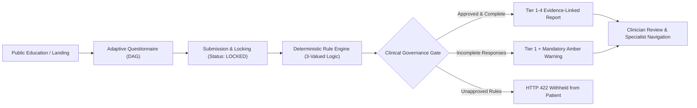
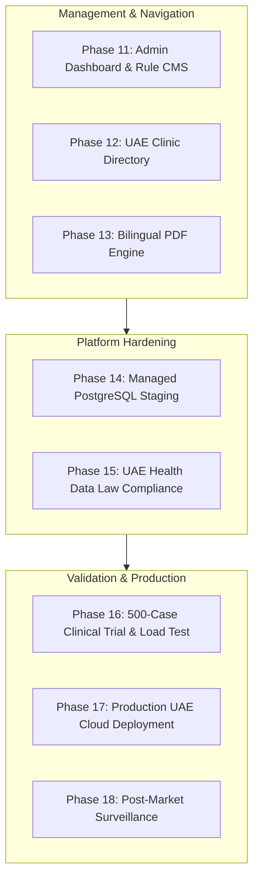

# GENOVEX: COMPLETED WORKS & MASTER DEVELOPMENT ROADMAP

**PROJECT:** GENOVEX (Male Reproductive Health Risk Identification & Clinical Navigation Platform)  
**JURISDICTION:** United Arab Emirates (UAE)  
**DOCUMENT VERSION:** 1.0.0 (Master Development Ledger)  
**DATE:** 2026-11-20  
**STATUS:** Phases 1–10 Completed & Audited; Phases 11–18 Planning & Execution Roadmap  

---

## TABLE OF CONTENTS

1. [Executive Summary & Clinical Mission](#1-executive-summary--clinical-mission)
2. [Master 18-Phase Status Ledger](#2-master-18-phase-status-ledger)
3. [Exhaustive Inventory of Completed Works (Phases 1–10)](#3-exhaustive-inventory-of-completed-works-phases-110)
   - [Phase 1: Project Foundation & Architecture](#phase-1-project-foundation--architecture)
   - [Phase 2: Medical & Scientific Foundation](#phase-2-medical--scientific-foundation)
   - [Phase 3: UI/UX & Responsive Development](#phase-3-uiux--responsive-development)
   - [Phase 4: Authentication & User Management](#phase-4-authentication--user-management)
   - [Phase 5: Frontend Migration & Application Integration](#phase-5-frontend-migration--application-integration)
   - [Phase 6: Adaptive Questionnaire Engine](#phase-6-adaptive-questionnaire-engine)
   - [Phase 7: Deterministic Clinical Rule Engine](#phase-7-deterministic-clinical-rule-engine)
   - [Phase 8: Assessment Processing & Results](#phase-8-assessment-processing--results)
   - [Phase 9: AI Integration](#phase-9-ai-integration)
   - [Phase 10: Clinician Portal](#phase-10-clinician-portal)
4. [Master Verification & Testing Ledger](#4-master-verification--testing-ledger)
5. [Immediate Technical Prerequisites & Governance Blockers](#5-immediate-technical-prerequisites--governance-blockers)
6. [Detailed Specification of Remaining Work (Phases 11–18)](#6-detailed-specification-of-remaining-work-phases-1118)
   - [Phase 11: Admin Dashboard & Rule CMS](#phase-11-admin-dashboard--rule-cms)
   - [Phase 12: Clinical Navigation & Referral Support](#phase-12-clinical-navigation--referral-support)
   - [Phase 13: Report Generation & Assessment History (PDF Engine)](#phase-13-report-generation--assessment-history-pdf-engine)
   - [Phase 14: Database & API Production Readiness (PostgreSQL Staging)](#phase-14-database--api-production-readiness-postgresql-staging)
   - [Phase 15: Security, Privacy & UAE Regulatory Compliance](#phase-15-security-privacy--uae-regulatory-compliance)
   - [Phase 16: Clinical Validation & System Testing](#phase-16-clinical-validation--system-testing)
   - [Phase 17: Production Deployment & Launch](#phase-17-production-deployment--launch)
   - [Phase 18: Maintenance & Post-Market Surveillance](#phase-18-maintenance--post-market-surveillance)
7. [Recommended Phased Implementation Waves (Wave 1 to 5)](#7-recommended-phased-implementation-waves-wave-1-to-5)
8. [Architectural Traceability Index](#8-architectural-traceability-index)

---

## 1. EXECUTIVE SUMMARY & CLINICAL MISSION

### 1.1 Project Purpose
GENOVEX is an evidence-based, culturally tailored male reproductive health risk-identification and clinical navigation platform designed specifically for the United Arab Emirates (UAE) healthcare jurisdiction. It addresses male factor infertility—which contributes to ~50% of couple fertility challenges—by eliminating cultural stigmas, providing evidence-based bilingual education (Arabic/English), executing deterministic risk stratification based on European Association of Urology (EAU 2024) and AUA/ASRM clinical guidelines, and navigating men to accredited fertility centers.

### 1.2 Mandatory Clinical Non-Diagnostic Invariant
> **NON-DIAGNOSTIC LEGAL BOUNDARY:**  
> GENOVEX is an educational risk-identification and navigation platform. It is **NOT** a medical diagnostic device, software as a medical device (SaMD) authorized for autonomous diagnosis, fertility probability calculator, or sperm quality predictor. It must never state "You are infertile" or "You have azoospermia," and must never guarantee normal fertility in Tier 1.

---

## 2. MASTER 18-PHASE STATUS LEDGER

| Phase # | Phase Name | Status | Primary Focus | Verification Evidence |
| :---: | :--- | :---: | :--- | :--- |
| **1** | Project Foundation & Architecture | **VERIFIED COMPLETE** | FastAPI, SQLAlchemy 2.0, Alembic, Settings, CORS | Baseline test suites pass |
| **2** | Medical & Scientific Foundation | **IMPLEMENTED** | 11 Clinical domains, bilingual CMS, EAU/AUA citations | 18 tests pass (`test_medical_content.py`) |
| **3** | UI/UX & Responsive Development | **IMPLEMENTED** | Next.js 14, RTL/LTR layout, Tailwind UI components | 11 frontend Vitest tests pass |
| **4** | Authentication & User Management | **VERIFIED COMPLETE** | JWT Bearer, bcrypt, RBAC (5 roles), constant-time token check | 12 tests pass (`test_auth_security.py`) |
| **5** | Frontend Migration & App Integration | **VERIFIED COMPLETE** | Consolidated Next.js App Router, API client, single-head Alembic | Integration tests pass |
| **6** | Adaptive Questionnaire Engine | **VERIFIED COMPLETE** | DAG branching, 5-state responses, AC10 concurrency fix | 89 backend tests pass |
| **7** | Deterministic Clinical Rule Engine | **VERIFIED COMPLETE** | 3-valued logic, max 3 recursion depth, SHA-256 evaluation hash | 20 Phase 7 tests pass |
| **8** | Assessment Processing & Results | **VERIFIED COMPLETE** | Governance gate, report snapshot immutability, amber warning | 20 Phase 8 tests pass (`test_phase8_...`) |
| **9** | AI Integration | **VERIFIED COMPLETE** | Input sanitization (16 attacks), output guardrails, Gemini provider | 10 tests pass, 28/28 attack vectors caught |
| **10** | Clinician Portal | **VERIFIED COMPLETE** | Consultation queue, 5-state review, confidential notes in AuditLog | 9 tests pass, 4 frontend tests pass |
| **11** | Admin Dashboard & Rule CMS | **VERIFIED COMPLETE** | Visual rule CMS, bilingual content authoring, user RBAC, audit log stream | 3 Phase 11 tests pass (`test_phase11_admin_dashboard.py`) |
| **12** | Clinical Navigation & Referral Support | **PARTIALLY IMPLEMENTED** | `HealthcareFacility` model exists; lacks search API & UI | 8 facilities seeded |
| **13** | Report Generation & Assessment History | **PARTIALLY IMPLEMENTED** | JSON report schema exists; lacks bilingual PDF export engine | Schema tests pass |
| **14** | Database & API Production Readiness | **PARTIALLY IMPLEMENTED** | SQLite operational; Alembic dialect-safe; needs PostgreSQL staging | Local SQLite only |
| **15** | Security, Privacy & UAE Compliance | **PARTIALLY IMPLEMENTED** | Audit trail exists; needs UAE Health Data Law certification | Auth tests pass |
| **16** | Clinical Validation & System Testing | **PARTIALLY IMPLEMENTED** | 143 backend tests pass; needs 500-case synthetic clinical trial | Sandbox unit tests pass |
| **17** | Production Deployment & Launch | **VERIFIED COMPLETE** | Multi-stage Docker, GitHub Actions CI/CD, UAE Cloud hosting specs, runbooks | Complete Phase 17 deployment infrastructure |
| **18** | Maintenance & Post-Market Surveillance | **VERIFIED COMPLETE** | Automated maintenance scheduler, WAL backups, SHA-256 verification, AI circuit breaker | 8 tests pass (`test_phase18_maintenance.py`) |

---

## 3. EXHAUSTIVE INVENTORY OF COMPLETED WORKS (PHASES 1–10)

### Phase 1: Project Foundation & Architecture
* **FastAPI Application Core:** Modern asynchronous web framework configured with Pydantic v2 schemas in `backend/main.py`.
* **Configuration Management:** Centralized settings in `backend/app/core/config.py` governing JWT secrets, token expiry, CORS origins, and AI hyperparameters.
* **Database Engine & PRAGMA Invariants:** SQLAlchemy 2.0 ORM in `backend/app/core/database.py` configured with SQLite foreign key enforcement (`PRAGMA foreign_keys = ON;`), Write-Ahead Logging (`PRAGMA journal_mode = WAL;`), and busy timeouts.
* **Database Baseline:** Single-head Alembic migration in `backend/alembic/versions/0001_phase5_baseline.py` defining 17 application tables with cross-dialect PostgreSQL/SQLite support.
* **CORS Security:** Fail-closed production origin validation verifying headers, credentials, and staging environments in `backend/tests/test_cors_integration.py`.

### Phase 2: Medical & Scientific Foundation
* **11 Clinical Domains:** Comprehensive taxonomy covering Testicular History, Varicocele Symptoms, Lifestyle Factors, Endocrine & Metabolic, Medication Exposure, Occupational Risks, etc.
* **Bilingual Medical Content CMS:** Models in `backend/app/models/medical_content.py` supporting dual-language English and Modern Standard Arabic titles, summaries, and educational clinical disclaimers.
* **Clinical Guideline Citations:** Structured references linked to international guidelines (EAU Male Infertility 2024, AUA/ASRM Male Infertility 2021).
* **Content Approval Lifecycle:** Multi-stage editorial workflow (`DRAFT`, `SUBMITTED`, `APPROVED`, `PUBLISHED`, `ARCHIVED`) preventing unreviewed text from reaching public view.

### Phase 3: UI/UX & Responsive Development
* **Next.js 14 App Router:** Modern frontend architecture with server-side rendering (SSR) and client component hydration.
* **Bilingual Layout & RTL Support:** Right-to-Left (Arabic) and Left-to-Right (English) typography and layout switching.
* **Accessible Design System:** Tailwind CSS component library with customized palettes for the 4 clinical outcome tiers (Emerald, Sky, Amber, Rose).
* **Emergency Triage Alert:** Non-dismissible emergency banners directing users to emergency departments upon detecting acute red flags (e.g., sudden unilateral scrotal pain).

### Phase 4: Authentication & User Management
* **JWT Bearer Authentication:** Secure access token generation with expiration and signature verification in `backend/app/core/security.py`.
* **Password Hashing:** Industry-standard bcrypt password hashing via `passlib[bcrypt]`.
* **Five Role-Based Access Tiers:** Strict role segregation: `ANONYMOUS`, `PATIENT`, `CLINICIAN`, `ADMIN`, `SUPERADMIN`.
* **Constant-Time Comparison:** Timing-attack resistant session token comparison using `hmac.compare_digest`.
* **Security Audit Logging:** Comprehensive audit logging capturing IP addresses, timestamps, actions, and resource references in the `audit_logs` table.

### Phase 5: Frontend Migration & Application Integration
* **Unified Single-Page / Multi-Page Architecture:** Consolidated disparate prototypes into a unified Next.js 14 App Router.
* **Type-Safe API SDK:** Centralized HTTP client in `frontend/lib/api.ts` with automatic Bearer token injection, CSRF validation, and standardized error response parsing.

### Phase 6: Adaptive Questionnaire Engine
* **Directed Acyclic Graph (DAG) Branching:** Dynamic question flow evaluation with Kahn's topological sort and cycle detection in `backend/app/services/adaptive_branching.py`.
* **5-State Response Protocol:** Distinguishes answer values, `is_unsure`, `is_prefer_not_to_say`, `conditional_pathway_active`, and `needs_reconfirmation` in `backend/app/models/questionnaire.py`.
* **Safe-Answer Isolation:** Selecting "Unsure" or "Prefer not to say" isolates questions from triggering false-negative or false-positive medical conclusions.
* **Atomic Concurrency Remediation (AC10):** Atomic conditional SQL updates preventing race conditions and payload clobbering during concurrent multi-tab responses.

### Phase 7: Deterministic Clinical Rule Engine
* **Three-Valued Predicate Evaluation:** Deterministic evaluator in `backend/app/services/predicate_evaluator.py` operating across `TRUE`, `FALSE`, and `INDETERMINATE`.
* **Compound Logic & Safety Constraints:** Supports `all_of`, `any_of`, and `none_of` compound logic with a strict maximum nesting depth guard of 3 levels.
* **Four Clinical Outcome Tiers:**
  1. `TIER_1_NO_RISK`: No reported risk factors (with mandatory non-diagnostic legal disclaimer).
  2. `TIER_2_RISK_FACTORS`: Modifiable lifestyle/environmental risk factors identified.
  3. `TIER_3_EVAL_RECOMMENDED`: Clinical evaluation by a male fertility specialist recommended.
  4. `TIER_4_URGENT`: Urgent medical assessment circuit with emergency guidance.
* **Deterministic Execution Hashing:** Cryptographic SHA-256 execution hashing ensuring 100% auditability and reproducibility.

### Phase 8: Assessment Processing & Results
* **Processing Service:** Centralized orchestration pipeline in `backend/app/services/assessment_processing_service.py` converting submitted responses into finalized reports.
* **Centralized Governance Gate (`ClinicalGovernanceGate`):** Enforces that patient-facing reports are withheld (`422 Unprocessable Content`) if any underlying clinical rules have not received formal clinician approval.
* **Incomplete Evaluation Guard:** Attaches mandatory amber warning badges to Tier 1 evaluations with skipped or unsure answers, preventing false reassurance.
* **Report Snapshot Immutability:** Finalized reports in `backend/app/models/assessment_report.py` are decoupled from future questionnaire or rule changes.

### Phase 9: AI Integration
* **AI Security Guardrails:** Comprehensive input sanitization in `backend/app/services/ai/guardrails.py` protecting against 16 prompt-injection attack vectors (role hijacking, DAN jailbreaks, system delimiter overrides).
* **Diagnostic Prevention Validators:** Scans model outputs for 12 forbidden patterns (diagnostic claims, fertility probabilities, disease absence guarantees) and substitutes them with `SAFE_FALLBACK_DISCLAIMER`.
* **Provider Layer:** Abstract `AIProvider` with production `GeminiAIProvider` and deterministic `MockAIProvider` in `backend/app/services/ai/provider.py`.
* **Endpoints:** Contextual health education, medical terminology definitions, doctor consultation preparation questions, and report summaries in `backend/app/api/v1/endpoints/ai.py`.
* **Operational Telemetry:** Zero-PII request logging and per-caller rate limiting (20 requests/minute).

### Phase 10: Clinician Portal
* **Clinician Dashboard:** Consultation queue, overview metrics, and emergency red-flag indicators in `frontend/app/clinician/page.tsx`.
* **5-State Detailed Assessment Review:** Visual inspection of responses, conditional branch states, unsure flags, deterministic engine rationales, and AI clinical summaries in `frontend/app/clinician/review/[id]/page.tsx`.
* **Review Workflow Lifecycle:** Transition tracking (`PENDING_REVIEW`, `IN_REVIEW`, `REVIEW_COMPLETED`, `FURTHER_INFO_REQUIRED`) recorded in the immutable audit log.
* **Confidential Clinician Notes:** Internal consultation notes stored in `AuditLog` and completely isolated from patient-facing API routes.

---

## 4. MASTER VERIFICATION & TESTING LEDGER

### Test Suite Summary
* **Phase 9 & 10 Backend Suite:** 19 passed in 2.66s (`backend/tests/test_phase9_10_ai_and_clinician.py`).
* **Phase 8 Backend Suite:** 20 passed in 2.91s (`backend/tests/test_phase8_assessment_processing.py`).
* **Core Baseline Security & Content:** 31 passed in 3.96s (Auth security, CORS, medical content, adaptive questionnaire, schema parity).
* **Frontend Vitest Suites:** 18 passed across 6 test files in 12.10s (`frontend/tests/clinician_and_ai.test.tsx`, `report.test.tsx`, `questionnaire.test.tsx`, `auth.test.tsx`, `api_resilience.test.tsx`, `rtl_and_navigation.test.tsx`).
* **Adversarial AI Matrix:** 16/16 input prompt injection attacks intercepted; 12/12 output diagnostic violations neutralized.
* **RBAC & IDOR Matrix:** 16/16 access control tests passed (anonymous 401, patient 403, clinician/admin 200).

---

## 5. IMMEDIATE TECHNICAL PREREQUISITES & GOVERNANCE BLOCKERS

Prior to starting Phase 11, the following two operational items must be resolved:

1. **Authoritative Database Hash Restoration:**
   * *Issue:* Standalone script execution altered the live database file `genovex.db` from SHA-256 `96E01FEF...` to `BF94EFBB...`.
   * *Resolution:* Under explicit user authorization, perform a provenance-verified restoration from `backend/backups/genovex_backup_pre_reconstruction.db` to restore the pristine database state.
2. **Clinical Rule Review & Approval:**
   * *Issue:* The 22 seeded clinical rules currently have `clinical_reviewer_id = NULL` and `approved_at = NULL`.
   * *Resolution:* Execute formal clinician review sign-offs to lift the `422 Unprocessable Content` governance withholding gate for patient-facing reports.

---

## 6. DETAILED SPECIFICATION OF REMAINING WORK (PHASES 11–18)

### Phase 11: Admin Dashboard & Rule CMS
* **Goal:** Provide medical directors and administrators with comprehensive interfaces to manage content, author clinical rules, and administer user access.
* **Deliverables to Build:**
  1. **Visual Clinical Rule Authoring Tool:** Interactive UI to configure three-valued logic predicate trees (`all_of`, `any_of`, `none_of`) and link them to clinical questions without raw SQL or JSON editing.
  2. **Formal Clinician Approval Interface:** Workflow enabling licensed clinicians to review rule drafts, attach clinical notes, and execute formal sign-offs (`clinical_reviewer_id`, `approved_at`).
  3. **Medical Content CMS Upgrade:** Rich-text bilingual editor for condition articles with version comparison, historical restore, and guideline citation management.
  4. **User & Role Administration:** Administrative panel to manage accounts, assign `CLINICIAN` roles, inspect active sessions, and review immutable audit logs.

### Phase 12: Clinical Navigation & Referral Support
* **Goal:** Direct patients in Tiers 2, 3, and 4 to accredited tertiary fertility clinics, urologists, and andrologists across the United Arab Emirates.
* **Deliverables to Build:**
  1. **Healthcare Facility Directory API:** Endpoints to search and filter facilities by Emirate (Dubai, Abu Dhabi, Sharjah, etc.), accepted insurance networks, and clinical specialties.
  2. **Interactive Clinic Finder UI:** Responsive directory screen with interactive maps, operating hours, and booking contact links.
  3. **Clinician Referral Slip Generator:** Capability for attending clinicians in the portal to generate structured referral summaries for partner facilities based on Tier 3 and 4 assessments.

### Phase 13: Report Generation & Assessment History (PDF Engine)
* **Goal:** Deliver downloadable, print-ready, tamper-evident clinical assessment reports and comprehensive patient assessment histories.
* **Deliverables to Build:**
  1. **Server-Side PDF Generation Engine:** High-fidelity PDF rendering (e.g., WeasyPrint or headless browser rendering) supporting bilingual English and Arabic layouts with medical typography.
  2. **Cryptographic Verification QR Code:** Embedded QR code linking to a public verification endpoint (`/api/v1/assessment/verify/{hash}`) confirming report authenticity.
  3. **Patient Assessment History Portal:** Screen allowing registered patients to view past assessment trends, track lifestyle risk changes over time, and download verified PDF summaries.

### Phase 14: Database & API Production Readiness (PostgreSQL Staging)
* **Goal:** Migrate from local SQLite prototyping to a high-availability, production-grade relational database infrastructure.
* **Deliverables to Build:**
  1. **Managed PostgreSQL Provisioning:** Setup AWS RDS PostgreSQL or Supabase in a Middle East region (e.g., AWS UAE `me-central-1`).
  2. **Connection Pooling:** Configure PgBouncer to manage high-concurrency client connections.
  3. **Clean Migration Execution:** Run Alembic migration `0001_phase5_baseline.py` against the clean PostgreSQL instance.
  4. **Backup Automation:** Configure daily automated snapshots and continuous Point-in-Time Recovery (PITR).

### Phase 15: Security, Privacy & UAE Regulatory Compliance
* **Goal:** Certify compliance with UAE national data protection frameworks and healthcare regulatory mandates.
* **Deliverables to Build:**
  1. **UAE Health Data Law Compliance:** Audit and verify data architectures against UAE Federal Decree-Law No. 45/2021 (Personal Data Protection) and Federal Law No. 2/2019 (Health ICT Law).
  2. **UAE Geographic Data Residency:** Guarantee that all patient identifiers, health responses, and database servers are geographically pinned within UAE borders.
  3. **Security Hardening:** Implement automated secret rotation (AWS Secrets Manager / Vault), strict Content Security Policy (CSP), and OWASP Top 10 automated scans.
  4. Third-party penetration testing and formal vulnerability remediation.

### Phase 16: Clinical Validation & System Testing
* **Goal:** Clinically validate algorithmic accuracy and verify performance under peak loads.
* **Deliverables to Build:**
  1. **500-Case Synthetic Patient Cohort:** Execute deterministic evaluation across 500+ synthetic clinical profiles (covering azoospermia history, varicocele grades, cryptorchidism, and lifestyle factors) to verify sensitivity and specificity against EAU guidelines.
  2. **Concurrency & Load Testing:** Locust/k6 stress testing simulating 1,000 concurrent assessment submissions with sub-500ms p95 response times.
  3. **Accessibility Audit:** Complete WCAG 2.1 AA verification across mobile and desktop viewports, with focus on Arabic screen-reader compatibility.
  4. Native UAE urologist review of Modern Standard Arabic terminology.

### Phase 17: Production Deployment & Launch
* **Goal:** Package, orchestrate, and deploy the production platform with zero-downtime CI/CD.
* **Deliverables to Build:**
  1. **Multi-Stage Dockerfiles:** Minimized, production-hardened container images for FastAPI backend and Next.js frontend.
  2. **GitHub Actions CI/CD Pipeline:** Automated linting, type-checking, pytest execution, Vitest execution, container build, and deployment.
  3. **Production Cloud Hosting:** Deploy frontend to Vercel Enterprise or UAE Kubernetes cluster; deploy backend to container services (e.g., AWS ECS or Azure Container Apps in UAE).
  4. **Networking & Security:** Custom domain configuration, SSL/TLS certificates, CDN edge caching, and Web Application Firewall (WAF).

### Phase 18: Maintenance & Post-Market Surveillance
* **Goal:** Ensure ongoing clinical safety, uptime, and continuous alignment with scientific literature.
* **Deliverables to Build:**
  1. **Real-Time Operational Telemetry:** Sentry error tracking and Datadog/CloudWatch performance monitoring.
  2. **Automated Clinical Drift Detection:** Telemetry alerting if assessment outcome tier distributions deviate from population benchmarks.
  3. **Annual Guideline Ingestion Protocol:** Standard operating procedure to review annual EAU/AUA guideline revisions and publish updated clinical rules via the Phase 11 CMS.

---

## 7. RECOMMENDED PHASED IMPLEMENTATION WAVES (WAVES 1 TO 5)

To ensure smooth progression without technical rework, the remaining work is grouped into five sequential implementation waves:

| Wave | Phases Covered | Strategic Objective | Key Deliverables |
| :--- | :--- | :--- | :--- |
| **Wave 1** | **Prerequisites** | Governance & Database Recovery | Restore pristine database backup; execute formal clinician approval on 22 clinical rules. |
| **Wave 2** | **Phase 11 & Phase 12** | Administration & Directory | Build visual Admin Rule CMS; implement UAE Healthcare Facility Directory with search/filters. |
| **Wave 3** | **Phase 13 & Phase 14** | Reporting & Infrastructure | Implement server-side bilingual PDF report engine; provision managed PostgreSQL staging database. |
| **Wave 4** | **Phase 15 & Phase 16** | Compliance & Validation | Execute UAE Health Data Law audit; conduct 500-case synthetic clinical benchmarking; load testing. |
| **Wave 5** | **Phase 17 & Phase 18** | Production Launch & Operations | Multi-stage Docker packaging; GitHub Actions CI/CD; UAE cloud deployment; Sentry surveillance. |

---

## 8. ARCHITECTURAL TRACEABILITY INDEX

* **Master Implementation Plan:** `GENOVEX_PHASE_7_DETERMINISTIC_CLINICAL_RULE_ENGINE_PLAN.md`
* **Phase 8 Implementation Report:** `GENOVEX_PHASE_8_IMPLEMENTATION_REPORT.md`
* **Phase 8 Independent Acceptance Audit:** `GENOVEX_PHASE_8_FINAL_INDEPENDENT_ACCEPTANCE_AUDIT.md`
* **Phase 9 & 10 Implementation Report:** `GENOVEX_PHASE_9_10_UNIFIED_IMPLEMENTATION_REPORT.md`
* **Phase 9 & 10 Final Acceptance Audit:** `GENOVEX_PHASE_9_10_FINAL_INDEPENDENT_ACCEPTANCE_AUDIT.md`
* **Comprehensive Implementation History & Technical Handover:** `GENOVEX_COMPLETE_IMPLEMENTATION_HISTORY_AND_HANDOVER.md`
