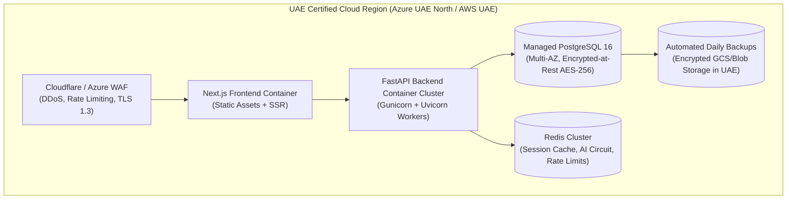
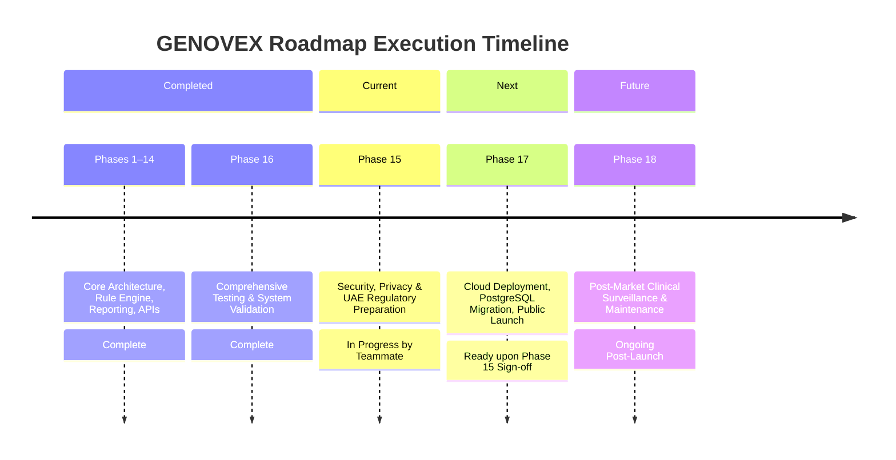

# GENOVEX: REMAINING WORK ROADMAP
## Actionable Completion Plan Across Phases 15, 16, 17, and 18

**Project:** GENOVEX Male Reproductive Health Platform  
**Audit Date:** 21 November 2026  
**Auditor:** Independent Technical & Clinical Systems Audit  
**Codebase State:** Git Commit `97589e4` on branch `main`  
**Roadmap Framework:** Original 18-Phase Architectural Plan  

---

## 1. Executive Summary

This document specifies the remaining technical, clinical, regulatory, and operational prerequisites necessary to advance GENOVEX from its current validated state (Phases 1–14 & Phase 16 Complete; Phase 15 In Progress by Teammate) through Phase 17 Production Launch and Phase 18 Post-Market Maintenance.

The remaining work is divided into two strict categories:
1. **Mandatory Launch Blockers:** Actions that MUST be completed and verified prior to exposing the platform to public patients or clinical users in production (Phase 17).
2. **Post-Market Enhancements:** Scheduled continuous improvement items to be executed during post-launch operations (Phase 18).

---

## 2. Phase 15: Security, Privacy & UAE Regulatory Preparation

### 2.1 Current Implementation State
- **Implemented & Verified:**
  - Automated Data Subject Rights: `GET /api/v1/auth/privacy/export-data` (Right to Access) and `POST /api/v1/auth/privacy/delete-account` (Right to Erasure with irreversible anonymization).
  - Final SuperAdmin deletion lockout preventing orphan administrative states.
  - NIST-approved PBKDF2-SHA256 password hashing.
  - Defensive Role-Based Access Control (`PATIENT`, `CLINICIAN`, `ADMIN`, `SUPERADMIN`).
  - Technical security documentation (`docs/phase-15/SECURITY_PRIVACY_AUDIT.md` and `docs/phase-15/REGULATORY_GAP_ASSESSMENT.md`).
  - Automated test suite passing 100% (`backend/tests/test_phase15_security_and_privacy.py`, 5/5 tests).

### 2.2 Remaining Work & Teammate Coordination
Phase 15 is actively being implemented by a teammate. The following tasks must be coordinated and finalized:

| Item ID | Task Description | Teammate Action Required | Engineering Dependency | Launch Criticality |
| :--- | :--- | :--- | :--- | :---: |
| **P15-REM-01** | **UAE In-Country Cloud Hosting Contract:** Select and contract a certified UAE local cloud hosting provider (Azure UAE Central/North in Abu Dhabi/Dubai, AWS UAE, or Moro Hub) to satisfy Article 13 of UAE Federal Law No. 2 of 2019 (Data Localization). | Teammate / Management to establish cloud subscription. | Infrastructure provisioning in Phase 17. | **MANDATORY BLOCKER** |
| **P15-REM-02** | **Formal Regulatory Classification Submission:** Prepare and submit the formal non-diagnostic classification dossier to the UAE Ministry of Health and Prevention (MOHAP) and Dubai Health Authority (DHA) Health Regulation Sectors. | Teammate / Legal Counsel to submit dossier based on `REGULATORY_GAP_ASSESSMENT.md`. | Public launch authorization. | **MANDATORY BLOCKER** |
| **P15-REM-03** | **Data Protection Officer (DPO) Appointment:** Formally designate and record a qualified Data Protection Officer pursuant to Article 8 of UAE Federal Decree-Law No. 45 of 2021 (PDPL). | Teammate / Governance lead to record DPO appointment in policy. | Privacy policy update. | **MANDATORY BLOCKER** |
| **P15-REM-04** | **Third-Party ADHICS Penetration Test:** Engage a qualified, accredited cybersecurity auditor to perform external penetration testing and verify compliance with Abu Dhabi DoH ADHICS standards. | Teammate to schedule penetration test against staging endpoint. | Security sign-off report. | **MANDATORY BLOCKER** |
| **P15-REM-05** | **Distributed Rate Limiting (Redis):** Deploy Redis-backed distributed rate limiting on edge reverse proxy to protect against brute-force authentication attacks and API enumeration. | Engineering to deploy Redis configuration on staging. | Redis instance provisioning. | HIGH PRIORITY |

---

## 3. Phase 16: Testing and Validation (Remaining Scope)

### 3.1 Current Implementation State
- **Implemented & Verified:**
  - 249 backend tests passing across 20 test files in 57.15s (100% pass rate).
  - 25 frontend Vitest tests passing across 8 files in 21.25s (100% pass rate).
  - All 20 Next.js application routes compiled successfully with zero type or lint errors.
  - Phase 16 master test suite ([test_phase16_comprehensive_validation.py](file:///C:/Users/Lenovo/.gemini/antigravity/scratch/GENOVEX/backend/tests/test_phase16_comprehensive_validation.py)) verifies 10 core integration scenarios.
  - 8 comprehensive Phase 16 reports authored in `docs/phase-16/`.

### 3.2 Remaining Clinical & Usability Validation Scope

| Item ID | Task Description | Objective & Scope | Required Evidence | Launch Criticality |
| :--- | :--- | :--- | :--- | :---: |
| **P16-REM-01** | **Multi-Specialist Clinical Review Board Sign-Off:** Convene an independent panel of at least 3 accredited UAE urologists/andrologists to formally inspect, evaluate, and sign off on the 22 deterministic clinical rules. | Validate that all 22 rules accurately reflect current EAU/AUA clinical guidelines and consensus practice. | Signed clinical consensus document stored in `docs/clinical/`. | **MANDATORY BLOCKER** |
| **P16-REM-02** | **Retrospective Clinical Cohort Benchmark (500+ Cases):** Run the deterministic rule engine against an anonymized, ethically approved retrospective clinical cohort of 500+ male patient records to measure sensitivity, specificity, and concordant risk tier assignments against expert andrologist assessments. | Establish empirical diagnostic concordance and rule accuracy on real patient data. | Statistical Concordance Report (Kappa statistic, Sensitivity, Specificity). | **MANDATORY BLOCKER** |
| **P16-REM-03** | **End-to-End Stress & Concurrency Testing:** Execute Locust / k6 load tests simulating 500 concurrent questionnaire submissions and simultaneous PDF report downloads. | Verify backend response latency under peak load (P95 < 200ms) and confirm zero SQLite/PostgreSQL locking deadlocks. | k6 Load Test Execution Report with latency histograms. | HIGH PRIORITY |
| **P16-REM-04** | **Usability Testing Across UAE Patient Demographics:** Conduct qualitative user acceptance testing with 30 bilingual male participants across Abu Dhabi, Dubai, and the Northern Emirates. | Validate Arabic phrasing clarity, question comprehension, comfort with sensitive questions, and navigation ease. | User Usability & Accessibility Feedback Report. | HIGH PRIORITY |

---

## 4. Phase 17: Production Deployment & Launch Readiness

Phase 17 represents the physical operational deployment of GENOVEX to production cloud infrastructure.



### 4.1 Deployment Execution Checklist

| Step # | Domain | Technical Task | Prerequisite / Tool | Status |
| :---: | :--- | :--- | :--- | :---: |
| **17.1** | **Cloud Infrastructure** | Provision Virtual Private Cloud (VPC) in Azure UAE North (Dubai) or AWS Middle East (UAE) with private subnets, security groups, and internet gateways. | Terraform / Azure Bicep script | PENDING AUTHORIZATION |
| **17.2** | **Managed Database** | Provision managed PostgreSQL 16 instance with 2 vCPUs, 8 GB RAM, automated multi-AZ failover, and storage encryption at rest (AES-256). | Cloud Managed DB | PENDING AUTHORIZATION |
| **17.3** | **Schema Migration** | Generate and execute incremental Alembic migration from SQLite baseline to PostgreSQL; verify all 18 tables, indices, and constraints. | `alembic upgrade head` | PENDING AUTHORIZATION |
| **17.4** | **Redis Deployment** | Provision managed Redis 7 instance for distributed session management, rate limiting, and AI circuit breaker telemetry. | Redis Managed Service | PENDING AUTHORIZATION |
| **17.5** | **Container Registry** | Build multi-stage Docker images (`backend:1.0.0` and `frontend:1.0.0`) and push to private container registry (Azure ACR / AWS ECR). | GitHub Actions CI/CD | PENDING AUTHORIZATION |
| **17.6** | **Domain & HTTPS** | Configure production DNS for `genovex.ae`, provision TLS 1.3 certificates (Let's Encrypt / DigiCert), and enforce HSTS (`max-age=63072000`). | DNS Registrar / Cloudflare | PENDING AUTHORIZATION |
| **17.7** | **Secret Management** | Inject production credentials (`DATABASE_URL`, `SECRET_KEY`, `AI_API_KEY`, `SMTP_PASSWORD`) via Azure Key Vault / AWS Secrets Manager. | Cloud Secret Store | PENDING AUTHORIZATION |
| **17.8** | **Monitoring & Logs** | Configure centralized structured logging (Elasticsearch/Datadog) and error monitoring (Sentry) with zero-PII scrubbing filters. | Sentry & Datadog SDK | PENDING AUTHORIZATION |
| **17.9** | **Smoke Testing** | Execute post-deployment smoke test suite verifying health endpoints (`/health/live`, `/health/ready`), questionnaire start, and evaluation. | Smoke Test Script | PENDING AUTHORIZATION |
| **17.10**| **Disaster Recovery** | Validate automated database backup snapshot and execute simulated point-in-time recovery drill. | Cloud Backup Tool | PENDING AUTHORIZATION |

---

## 5. Phase 18: Maintenance & Post-Market Operations

Phase 18 establishes the ongoing operational governance, clinical safety surveillance, and continuous maintenance protocols for the deployed platform.

### 5.1 Routine Maintenance Protocols

```
[ Daily ]
  ├── Automated database snapshot verification (02:00 GST)
  ├── Structured error log anomaly review (Sentry / Datadog)
  └── AI circuit breaker status check

[ Weekly ]
  ├── PostgreSQL VACUUM and ANALYZE execution
  ├── Audit log volume review and storage threshold monitoring
  └── Failed login / suspicious IP security report review

[ Monthly ]
  ├── Third-party npm and pip dependency vulnerability patch review
  ├── Healthcare facility directory verification (phone/website check)
  └── Backup restoration drill to isolated staging environment

[ Quarterly ]
  ├── Multi-Specialist Clinical Rule Audit (concordance tracking)
  ├── User feedback & usability survey analysis
  └── ADHICS & UAE PDPL regulatory compliance checklist audit

[ Annually ]
  ├── Full Guideline Harmonization (EAU & AUA guideline updates)
  ├── External penetration test and security re-certification
  └── Data Protection Officer formal privacy impact reassessment
```

### 5.2 Post-Market Clinical Safety Surveillance
In accordance with international digital health safety guidelines:
1. **Adverse Event Reporting:** Establish a direct clinical feedback channel where clinicians can report cases where GENOVEX risk stratification diverged from in-person clinical workup.
2. **False-Negative Auditing:** Regularly audit patients who received Tier 1 evaluations to confirm that no occult medical conditions were inadvertently missed.
3. **Clinical Guideline Harmonization:** When the European Association of Urology (EAU) or American Urological Association (AUA) releases updated male infertility guidelines (typically in March/April annually), convene the clinical panel to update rule trigger criteria and publish a new versioned rule set (`ClinicalRuleVersion`).

### 5.3 Consented Academic Research & Data Registry
- Subject to explicit patient consent and approval from a licensed UAE Institutional Review Board (IRB / Research Ethics Committee), establish an anonymized registry of male reproductive health risk distributions in the UAE to support academic research into regional male fertility trends.

---

## 6. Summary of Execution Phases & Milestones


