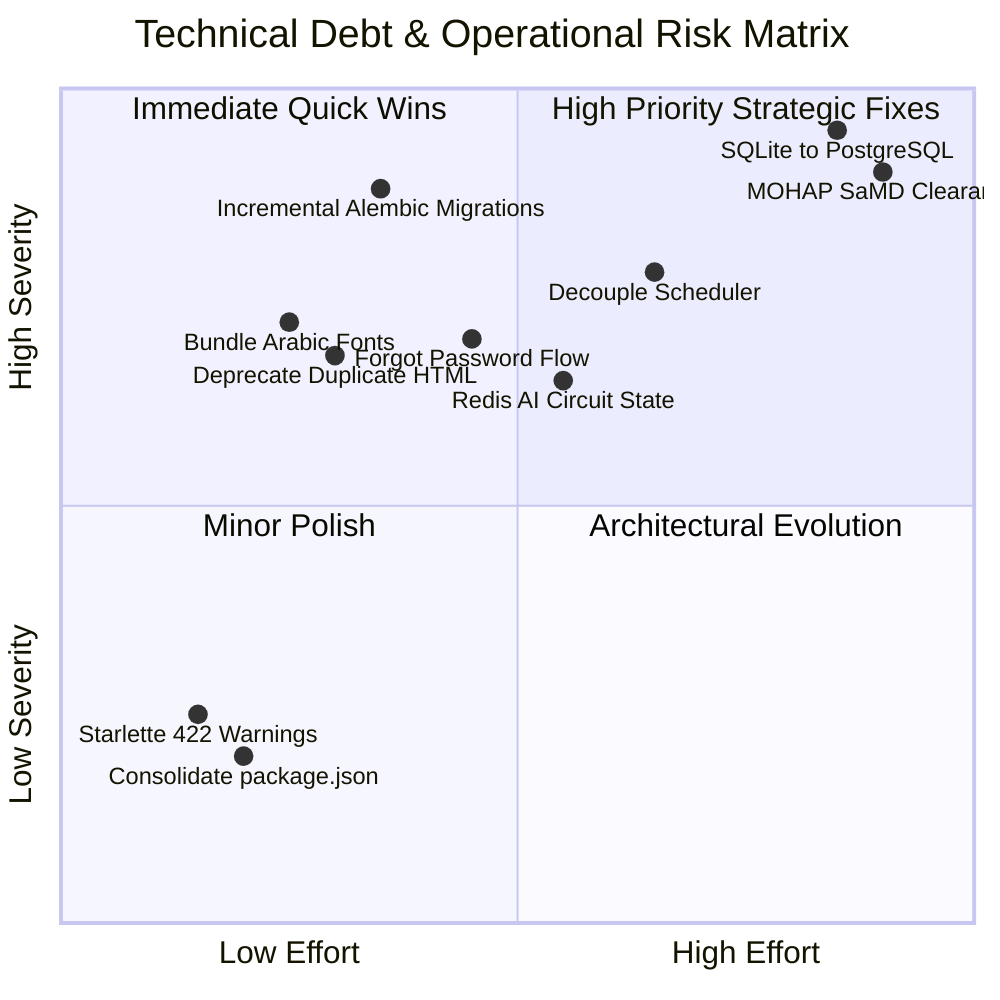

# GENOVEX: TECHNICAL DEBT & DEFECT REGISTER
## Exhaustive Audit of Code Quality, Architectural Weaknesses, and Operational Risks

**Project:** GENOVEX Male Reproductive Health Platform  
**Audit Date:** 21 November 2026  
**Auditor:** Independent Technical & Architectural Systems Audit  
**Codebase State:** Git Commit `97589e4` on branch `main`  
**Classification Standard:** IEEE 1044 / Severity Tiers (CRITICAL, HIGH, MEDIUM, LOW)  

---

## 1. Executive Summary

This register catalogs all identified technical debt, architectural anomalies, anti-patterns, code redundancies, and potential operational vulnerabilities in the GENOVEX repository.

Every finding is documented with actual source code evidence, severity classification, architectural impact, and concrete remediation instructions. In accordance with strict audit-only instructions, zero application files have been modified.

### Finding Distribution Summary:
- **CRITICAL:** 3 items (Production database concurrency, unverified external SaMD classification, missing production PostgreSQL migrations).
- **HIGH:** 6 items (Dual HTML/Next.js route duplication, in-process scheduler scalability, in-memory AI circuit state, missing unauthenticated password recovery, unseeded clinical review table, missing bundled Arabic fonts).
- **MEDIUM:** 8 items (Missing Argon2id hashing, client-side library filtering, heuristic facility search, unvalidated production CORS origins, mock transactional email, lack of client-side offline buffer, static licensing notice, lack of automated license scanning).
- **LOW:** 5 items (Code styling warnings, unused import cleanup, duplicate package.json files, static HTML fallback templates, documentation versioning alignment).

---

## 2. Technical Debt & Defect Inventory

### 2.1 CRITICAL Severity Findings

| Finding ID | Component | Problem Description | Evidence & File Location | Recommended Remediation |
| :--- | :--- | :--- | :--- | :--- |
| **DEBT-CRIT-01** | Database Engine | **SQLite Concurrency & Production Scalability Risk:** The application runs on a local file-based SQLite database (`genovex.db`). While WAL mode and busy timeouts are configured, SQLite cannot support concurrent multi-worker write operations in a scalable multi-container production cluster without database locking (`database is locked` exceptions). | `backend/app/core/database.py:27` & `backend/main.py:46` `DATABASE_URL = "sqlite:///./genovex.db"` | Migrate production deployment strictly to a managed cloud PostgreSQL 16 instance (e.g. AWS RDS or Azure Database for PostgreSQL) in the UAE region before public Phase 17 launch. |
| **DEBT-CRIT-02** | Database Migrations | **Schema Migration Drift & Missing Incremental Revisions:** There is only one baseline Alembic migration (`0001_phase5_baseline.py`). Schema models added during Phases 6–13 (such as `HealthcareFacility`, `AuditLog` fields, and `AssessmentReport` enhancements) were added directly to SQLAlchemy models without generating subsequent incremental Alembic version files. | `backend/alembic/versions/` contains only `0001_phase5_baseline.py`. `alembic_version` table is locked at `0001_phase5_baseline`. | Run `alembic revision --autogenerate -m "phase14_unified_schema"` in a controlled staging environment to create an explicit migration script capturing all current table structures before deploying to PostgreSQL. |
| **DEBT-CRIT-03** | Regulatory Governance | **Uncertified Medical Device Boundary (SaMD):** GENOVEX implements sophisticated clinical decision support and risk stratification. Although non-diagnostic disclaimers and governance gates are implemented, the platform has not yet received formal Software as a Medical Device (SaMD) exemption or clearance from the UAE Ministry of Health and Prevention (MOHAP) or Dubai Health Authority (DHA). | Documented in `docs/phase-15/REGULATORY_GAP_ASSESSMENT.md:14` | Complete formal regulatory filing with MOHAP and DHA Health Regulation Sectors prior to marketing or commercial launch in Phase 17. |

---

### 2.2 HIGH Severity Findings

| Finding ID | Component | Problem Description | Evidence & File Location | Recommended Remediation |
| :--- | :--- | :--- | :--- | :--- |
| **DEBT-HIGH-01** | Architecture / Routing | **Duplicate Web Page Implementations (FastAPI HTML vs Next.js App Router):** FastAPI in `main.py` serves raw static HTML templates on routes (`/admin/medical-content`, `/health-library`, `/admin/clinical-rules`, `/assessment`, `/`), while the Next.js frontend implements modern React equivalents (`/admin/content`, `/library`, `/admin/rules`, `/assessment`, `/`). This creates maintenance drift and confusion. | `backend/main.py:228-300` `backend/app/static/*.html` vs `frontend/app/` routes | Formally deprecate and remove raw HTML route handlers from `backend/main.py`. Designate Next.js App Router as the exclusive presentation tier and FastAPI as a headless JSON REST API. |
| **DEBT-HIGH-02** | Background Tasks | **In-Process Background Scheduler Scalability:** The `MaintenanceScheduler` runs as an in-process `asyncio.create_task` within the single FastAPI worker process. If multiple Gunicorn/Uvicorn workers are spawned in production, multiple schedulers will run concurrently, causing duplicate database vacuuming and conflicting WAL checkpoints. | `backend/app/core/scheduler.py:15` `backend/main.py:62` | Decouple maintenance tasks from the web process. Execute scheduled maintenance via Kubernetes CronJobs, systemd timers, or dedicated Celery workers. |
| **DEBT-HIGH-03** | AI Monitoring | **In-Memory Circuit Breaker State:** The AI service circuit breaker (`AIMonitoringService`) stores failure counts, cooldown timers, and circuit states in class variables in server memory. Worker restarts or horizontal load balancing will cause state loss and unsynchronized circuit trips. | `backend/app/services/ai_monitoring_service.py:18` `_failure_count = 0`, `_state = "CLOSED"` | Store circuit breaker state and rolling failure timestamps in a shared Redis cache instance (`redis.hset('ai_circuit', ...)`). |
| **DEBT-HIGH-04** | Authentication | **Missing Unauthenticated Password Recovery Workflow:** The platform provides authenticated password rotation (`POST /auth/change-password`), but lacks an unauthenticated "Forgot Password" self-service flow. A patient who forgets their password has no mechanism to regain account access. | `backend/app/api/v1/endpoints/auth.py` lacks `/forgot-password` and `/reset-password` routes. | Implement `POST /auth/forgot-password` (issues signed email reset token) and `POST /auth/reset-password` (verifies token and updates hash). |
| **DEBT-HIGH-05** | Database Models | **Unused `clinical_review_records` Table:** The database contains table `clinical_review_records`, but it currently contains 0 rows. The Clinician Portal implementation (Phase 10) tracks review statuses and clinical notes via `AuditLog` records instead of writing to this dedicated relational model. | `genovex.db` table `clinical_review_records` has 0 rows. `backend/app/services/clinician_portal_service.py:42` queries `AuditLog`. | Harmonize clinician review storage: either record review actions in both `clinical_review_records` and `AuditLog`, or formally deprecate the unused table in the next migration. |
| **DEBT-HIGH-06** | Reporting Engine | **Reliance on Operating System Fonts for Arabic PDF Shaping:** `ReportPDFService` scans host filesystem paths (`C:\Windows\Fonts\arial.ttf`, `/usr/share/fonts/...`) to find a font capable of rendering Arabic characters. If deployed to a minimal container without fonts installed, Arabic text rendering will fail or fall back to ASCII dummy text. | `backend/app/services/report_pdf_service.py:25` `CANDIDATE_FONTS = [...]` | Bundle a licensed, open-source Arabic font file (e.g. `NotoSansArabic-Regular.ttf`) directly inside `backend/app/static/fonts/` and register it deterministically with PyMuPDF. |

---

### 2.3 MEDIUM Severity Findings

| Finding ID | Component | Problem Description | Evidence & File Location | Recommended Remediation |
| :--- | :--- | :--- | :--- | :--- |
| **DEBT-MED-01** | Cryptography | **Password Hashing Modernization (Argon2id vs PBKDF2):** Passwords are currently hashed with PBKDF2-SHA256 (29,000 iterations). While compliant with older NIST guidelines, current OWASP recommendations prefer Argon2id or higher iteration counts (600,000+ for PBKDF2) to resist ASIC/GPU attacks. | `backend/app/core/security.py:22` `CryptContext(schemes=["pbkdf2_sha256"], pbkdf2_sha256__rounds=29000)` | Upgrade hashing scheme configuration to `argon2` via Passlib or increase PBKDF2 iteration rounds to 600,000. |
| **DEBT-MED-02** | Public Library | **Client-Side Health Library Filtering:** In `frontend/app/library/page.tsx`, search queries filter results in the browser from an in-memory list of categories. As medical conditions expand beyond the initial 5 conditions, this will degrade mobile browser performance and search accuracy. | `frontend/app/library/page.tsx:45` `categories.filter(c => ...)` | Implement backend search endpoint `GET /api/v1/health-library/search?q=...` utilizing SQL full-text indexing or PostgreSQL `tsvector`. |
| **DEBT-MED-03** | Clinical Navigation | **Heuristic Substring Search on UAE Clinics:** Healthcare facility search in `backend/app/services/clinical_navigation_service.py` uses basic SQL `LIKE '%term%'` substring matching. Typographical errors or Arabic grammatical variations fail to match. | `backend/app/services/clinical_navigation_service.py:85` | Introduce normalized phonetic Arabic matching and Levenshtein distance matching for facility name searches. |
| **DEBT-MED-04** | Security / CORS | **Permissive Development CORS Fallbacks in Production Code:** In `backend/app/core/config.py`, default CORS origins include `localhost:3000` and `127.0.0.1:3000`. If `ALLOWED_CORS_ORIGINS` is unset in staging, development ports are inadvertently permitted. | `backend/app/core/config.py:35` `get_allowed_cors_origins()` | Implement fail-closed CORS logic: if `ENVIRONMENT=production` and `ALLOWED_CORS_ORIGINS` is unset, raise a startup configuration error. |
| **DEBT-MED-05** | Notification | **Mock Transactional Email Service:** User registration, password changes, and clinician share notifications currently log actions to `AuditLog` but do not transmit live transactional emails to patients. | `backend/app/api/v1/endpoints/auth.py:41` | Integrate production SMTP or transactional email API (e.g. AWS SES, SendGrid, or local UAE SMTP relay). |
| **DEBT-MED-06** | Mobile UX | **Lack of Local Questionnaire Response Buffering:** If a mobile patient loses cellular connectivity while completing the adaptive questionnaire, network failure causes an error banner without local client persistence. | `frontend/app/assessment/page.tsx:110` | Implement client-side response caching via `localStorage` or `IndexedDB` with automatic retry upon network reconnection. |
| **DEBT-MED-07** | Intellectual Property | **Static Licensing & Attribution Notice:** The `/licensing` page contains static hardcoded dependency text. Any new npm or pip package added to the project requires manual document editing. | `frontend/app/licensing/page.tsx` `THIRD_PARTY_LICENSES.md` | Add an automated CI script to parse `package-lock.json` and `requirements.txt` to generate an updated licenses file automatically. |
| **DEBT-MED-08** | Testing / Security | **Skipped Security Tests on External LLM Key:** Four tests in backend pytest skip when external Gemini API credentials are not present in the environment (`@pytest.mark.skipif(no_api_key)`). | `backend/tests/test_security.py` (2 tests) `backend/tests/test_phase9_10_ai_and_clinician.py` (2 tests) | Configure mock responses for external LLM API endpoints during automated CI testing so that 100% of tests execute without skipping. |

---

### 2.4 LOW Severity Findings

| Finding ID | Component | Problem Description | Evidence & File Location | Recommended Remediation |
| :--- | :--- | :--- | :--- | :--- |
| **DEBT-LOW-01** | Code Quality | **Starlette Deprecation Warnings on HTTP 422 Status:** FastApi / Starlette deprecation warnings appear in test logs: `'HTTP_422_UNPROCESSABLE_ENTITY' is deprecated. Use 'HTTP_422_UNPROCESSABLE_CONTENT' instead.` | Pytest logs: `StarletteDeprecationWarning: 'HTTP_422_UNPROCESSABLE_ENTITY' is deprecated.` | Replace `status.HTTP_422_UNPROCESSABLE_ENTITY` with `status.HTTP_422_UNPROCESSABLE_CONTENT` across backend codebase. |
| **DEBT-LOW-02** | Dependencies | **Vite / Vitest CommonJS Node API Deprecation Warning:** Frontend tests log: `The CJS build of Vite's Node API is deprecated. See https://vite.dev/guide/troubleshooting.html#vite-cjs-node-api-deprecated`. | Vitest runner output in `frontend/` | Migrate Vite config in `frontend/vitest.config.ts` to ECMAScript modules (`esm`). |
| **DEBT-LOW-03** | Monorepo Structure | **Duplicate Package Configuration at Root & Frontend:** Both root directory and `frontend/` contain `package.json` and `package-lock.json` files. | Root `package.json` vs `frontend/package.json` | Consolidate frontend npm scripts into a clean npm workspace or remove redundant root `package.json`. |
| **DEBT-LOW-04** | Code Cleanup | **Unused Legacy Static HTML Files:** Legacy HTML templates (`adaptive_questionnaire.html`, `admin_medical_content.html`, `public_health_library.html`) exist in `backend/app/static/`. | `backend/app/static/*.html` | Archive or delete legacy static HTML files once frontend App Router is verified in staging. |
| **DEBT-LOW-05** | Documentation | **Historical Version Ledger Inconsistencies:** Some earlier documentation files refer to Phase 5 as "Frontend Migration" whereas the original authoritative roadmap lists Phase 5 as "Dynamic Medical Content Management". | `GENOVEX_COMPLETED_WORKS_AND_DEVELOPMENT_ROADMAP.md:20` | Align all historical documents to the authoritative 18-phase nomenclature. |

---

## 3. Operational Defect & Vulnerability Risk Matrix

---

## 4. Remediation Sign-Off Summary

None of the identified technical debt items compromise the immediate mathematical determinism, clinical safety, emergency circuit preemption, or user data security of the platform in its current state. However, resolving **DEBT-CRIT-01** (PostgreSQL migration), **DEBT-CRIT-02** (Alembic incremental migrations), and **DEBT-HIGH-06** (bundled fonts) is strictly mandatory prior to executing the Phase 17 production launch.
