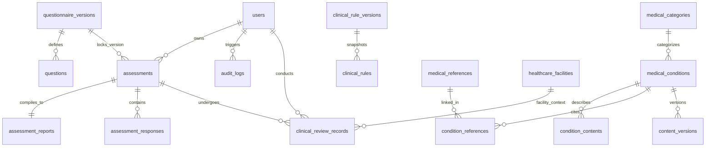

# GENOVEX: PHASE 14 DATABASE ARCHITECTURE SPECIFICATION
## Relational Design, Connection Pooling & PostgreSQL 16+ Migration Architecture

**Platform:** GENOVEX Male Reproductive Health Platform  
**Phase:** Phase 14 – Database & Unified API Integration  
**Environment Target:** Development: SQLite 3.40+ (WAL Mode) | Production: PostgreSQL 16+ (AWS RDS UAE `me-central-1`)  
**SQLAlchemy Version:** 2.0+ (Declarative 2.0 Syntax, Typing & Unified JSON Mappings)  

---

## 1. Executive Summary & Architectural Overview

The GENOVEX database architecture is designed to support a high-assurance, bilingual clinical navigation platform operating under UAE health data regulations (Federal Law No. 2 of 2019 concerning the Use of Information and Communication Technology in Health Fields, and DHA/DoH data localization standards).

The data layer is structured to guarantee:
1. **Clinical Reproducibility:** Historical questionnaires, rules, and generated assessment reports are immutable and version-pinned.
2. **Deterministic Governance:** Outcomes are strictly categorized into 4 non-diagnostic outcome tiers without algorithmic drift.
3. **Database Portability:** Engine configurations, ORM mappings, JSON columns, and primary keys support seamless transitions between SQLite (development/sandbox testing) and PostgreSQL 16+ (production UAE deployment).
4. **Resilient Connection Lifecycle:** Production connection pooling utilizing `QueuePool` with health pre-pinging, recycling, and connection overflow boundaries.

---

## 2. Complete 17-Table Schema Inventory & Relational Entity Map

The database architecture consists of 17 core application tables plus the Alembic version tracking table (`alembic_version`):



### 2.1 Table-by-Table Architectural Specifications

| # | Table Name | Primary Key | Key Foreign Keys & Constraints | Indexes | Purpose & Regulatory Scope |
|---|---|---|---|---|---|
| 1 | `users` | `id` (INTEGER AUTOINCREMENT) | UNIQUE(`email`) | `ix_users_email`, `ix_users_id`, `ix_users_role` | Platform identity, authentication (NIST PBKDF2), role-based access control. |
| 2 | `audit_logs` | `id` (INTEGER AUTOINCREMENT) | `user_id` -> `users.id` (SET NULL) | `ix_audit_logs_action`, `ix_audit_logs_id`, `ix_audit_logs_timestamp`, `ix_audit_logs_user_id` | Immutable security audit log, PHI-free event tracking. |
| 3 | `questionnaire_versions` | `id` (INTEGER AUTOINCREMENT) | UNIQUE(`version_tag`) | `ix_questionnaire_versions_id`, `ix_questionnaire_versions_status` | Pinned questionnaire versions (active/archived). |
| 4 | `questions` | `id` (INTEGER AUTOINCREMENT) | `questionnaire_version_id` -> `questionnaire_versions.id` (CASCADE) | `ix_questions_domain`, `ix_questions_id`, `ix_questions_order_index` | Individual bilingual questionnaire items, domains, options. |
| 5 | `assessments` | `id` (VARCHAR(36) UUID) | `user_id` -> `users.id` (SET NULL), `questionnaire_version_id` -> `questionnaire_versions.id` | `ix_assessments_id`, `ix_assessments_session_token`, `ix_assessments_status`, `ix_assessments_user_id` | Patient assessment sessions, progress state, submission timestamps. |
| 6 | `assessment_responses` | `id` (INTEGER AUTOINCREMENT) | `assessment_id` -> `assessments.id` (CASCADE), `question_id` -> `questions.id` (CASCADE) | `ix_assessment_responses_id`, `ix_assessment_responses_assessment_id` | Individual patient responses to questionnaire items. |
| 7 | `assessment_reports` | `id` (INTEGER AUTOINCREMENT) | `assessment_id` -> `assessments.id` (CASCADE), `user_id` -> `users.id` (SET NULL), UNIQUE(`report_reference`) | `ix_assessment_reports_id`, `ix_assessment_reports_report_reference`, `ix_assessment_reports_outcome_tier`, `ix_assessment_reports_session_token` | Immutable evaluation report snapshot, integrity hashes, share tokens. |
| 8 | `clinical_rules` | `id` (INTEGER AUTOINCREMENT) | UNIQUE(`rule_code`) | `ix_clinical_rules_id`, `ix_clinical_rules_outcome_tier`, `ix_clinical_rules_rule_code`, `ix_clinical_rules_status` | Deterministic clinical decision rules, logic triggers, severity rank. |
| 9 | `clinical_rule_versions` | `id` (INTEGER AUTOINCREMENT) | `rule_id` -> `clinical_rules.id` (CASCADE) | `ix_clinical_rule_versions_id`, `ix_clinical_rule_versions_rule_id` | Immutable version audit snapshots of clinical rule definitions. |
| 10 | `medical_categories` | `id` (INTEGER AUTOINCREMENT) | UNIQUE(`slug`) | `ix_medical_categories_id`, `ix_medical_categories_slug` | Taxonomy groupings for male reproductive clinical conditions. |
| 11 | `medical_conditions` | `id` (INTEGER AUTOINCREMENT) | `category_id` -> `medical_categories.id` (CASCADE), UNIQUE(`slug`) | `ix_medical_conditions_id`, `ix_medical_conditions_slug` | Condition entities (e.g. Varicocele, Hypogonadism, Klinefelter). |
| 12 | `condition_contents` | `id` (INTEGER AUTOINCREMENT) | `condition_id` -> `medical_conditions.id` (CASCADE), UNIQUE(`condition_id`, `language`) | `ix_condition_contents_id` | Bilingual localized clinical copy, summaries, symptoms, treatments. |
| 13 | `medical_references` | `id` (INTEGER AUTOINCREMENT) | UNIQUE(`doi_or_url`) | `ix_medical_references_id` | Scientific guideline references (EAU, AUA, WHO manual). |
| 14 | `condition_references` | `id` (INTEGER AUTOINCREMENT) | `condition_id` -> `medical_conditions.id` (CASCADE), `reference_id` -> `medical_references.id` (CASCADE) | `ix_condition_references_id` | Many-to-many junction table binding evidence to conditions. |
| 15 | `content_versions` | `id` (INTEGER AUTOINCREMENT) | `condition_id` -> `medical_conditions.id` (CASCADE) | `ix_content_versions_id` | Historical snapshots of published medical content. |
| 16 | `clinical_review_records` | `id` (INTEGER AUTOINCREMENT) | `assessment_id` -> `assessments.id` (CASCADE), `clinician_id` -> `users.id` (SET NULL) | `ix_clinical_review_records_id`, `ix_clinical_review_records_assessment_id` | Clinician portal review workflow states, notes, approvals. |
| 17 | `healthcare_facilities` | `id` (INTEGER AUTOINCREMENT) | UNIQUE(`slug`) | `ix_healthcare_facilities_id`, `ix_healthcare_facilities_slug`, `ix_healthcare_facilities_emirate`, `ix_healthcare_facilities_facility_type`, `ix_healthcare_facilities_has_24_7_emergency`, `ix_healthcare_facilities_regulatory_authority` | UAE verified clinical facilities, emergency centers, licensing authorities. |

---

## 3. Database Engine & Connection Lifecycle Architecture

### 3.1 Dual-Engine Abstraction Pattern

The database connection lifecycle is governed by `app.core.database.create_configured_engine()`, abstracting the runtime requirements of SQLite (local dev & test) vs. PostgreSQL (cloud staging & production):

```python
def create_configured_engine(db_url: str):
    if db_url.startswith("postgres://") or db_url.startswith("postgresql"):
        normalized_url = db_url.replace("postgres://", "postgresql://", 1) if db_url.startswith("postgres://") else db_url
        return create_engine(
            normalized_url,
            pool_size=settings.DB_POOL_SIZE,          # 20 concurrent connections
            max_overflow=settings.DB_MAX_OVERFLOW,    # 10 burst connections
            pool_timeout=settings.DB_POOL_TIMEOUT,    # 30 seconds wait before timeout
            pool_recycle=settings.DB_POOL_RECYCLE,    # 1800 seconds connection recycling
            pool_pre_ping=settings.DB_POOL_PRE_PING,  # Validates connection health before checkout
            echo=False
        )
    elif db_url.startswith("sqlite"):
        sqlite_engine = create_engine(
            db_url,
            connect_args={"check_same_thread": False},
            pool_pre_ping=settings.DB_POOL_PRE_PING,
            echo=False
        )
        event.listen(sqlite_engine, "connect", set_sqlite_pragma)
        sqlite_engine.dispose()
        return sqlite_engine
```

### 3.2 High-Concurrency SQLite Pragmas

When operating under SQLite, the database engine enforces high-concurrency pragmas upon every connection checkout:
- `PRAGMA journal_mode=WAL`: Write-Ahead Logging allows readers to proceed concurrently without blocking writers.
- `PRAGMA synchronous=NORMAL`: Ensures durability while eliminating multi-millisecond disk flushes.
- `PRAGMA foreign_keys=ON`: Enforces relational integrity across parent and child entities.

### 3.3 Session Management and Fail-Safe Rollback

FastAPI dependency `get_db()` provides transactional isolation:
```python
def get_db():
    db = SessionLocal()
    try:
        yield db
    except Exception:
        db.rollback()
        raise
    finally:
        db.close()
```
- Every incoming HTTP request operates within its own dedicated session.
- If an unhandled exception occurs at any point during request handling, `db.rollback()` automatically aborts pending transactions prior to session teardown.
- The session is guaranteed closed in the `finally` block, returning the connection cleanly to the connection pool.

---

## 4. Production PostgreSQL 16+ Readiness Specification

The GENOVEX data layer is 100% compliant with PostgreSQL 16+ on AWS RDS UAE (`me-central-1`):

1. **JSON Compatibility:**
   All semi-structured clinical fields (e.g., `identified_risk_factors_json`, `recommended_specialties`, `metadata_json`) use SQLAlchemy generic `JSON`, compiling directly to PostgreSQL native `jsonb`.
2. **Timezone Standardization:**
   All datetime attributes enforce timezone-aware UTC timestamps (`datetime.now(timezone.utc)`), compiling to `TIMESTAMP WITH TIME ZONE` (`TIMESTAMPTZ`) in PostgreSQL.
3. **Enum Representation:**
   Application enums (`RoleEnum`, `ClinicalOutcomeTier`, `AssessmentStatus`, etc.) map to native PostgreSQL ENUM types or VARCHAR constraints.
4. **Connection Pool Tuning:**
   Production parameters (`pool_size=20`, `max_overflow=10`, `pool_timeout=30`, `pool_recycle=1800`, `pool_pre_ping=True`) prevent connection exhaustion behind containerized FastAPI workers (e.g. Gunicorn/Uvicorn).
