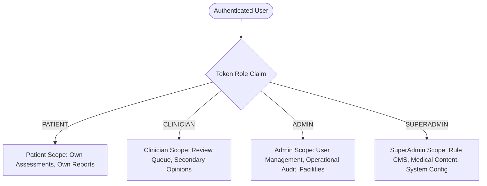

# GENOVEX: PHASE 14 SECURITY & DATA INTEGRITY SPECIFICATION
## Access Control (RBAC), IDOR Mitigations, Audit Logging & UAE Regulatory Compliance

**Platform:** GENOVEX Male Reproductive Health Platform  
**Phase:** Phase 14 – Database & Unified API Integration  
**Governance Standard:** UAE Federal Law No. 2 of 2019 (Health Data Law) & DHA/DoH Regulatory Standards  

---

## 1. Role-Based Access Control (RBAC) Matrix

GENOVEX enforces strict multi-tier Role-Based Access Control using cryptographic JWT claims validated on every request by FastAPI dependency `require_roles()`:



### 1.1 RBAC Permission Entitlements

| Resource / Action | Public / Guest | PATIENT | CLINICIAN | ADMIN | SUPERADMIN |
|---|:---:|:---:|:---:|:---:|:---:|
| Take Assessment & View Instant Non-Diagnostic Results | Yes | Yes | Yes | Yes | Yes |
| Claim Guest Assessment to Account | No | Yes | No | No | No |
| View Historical Assessments (`/assessments/history`) | No | Own Only | No | No | No |
| Compare Assessments (`/assessments/compare`) | No | Own Only | No | No | No |
| Generate & Revoke Expiring Share Links | No | Own Only | No | No | No |
| Access Shared Report via Token | Yes (with Token) | Yes (with Token) | Yes (with Token) | Yes | Yes |
| View Clinician Review Queue (`/clinician/reviews`) | No | No | Yes | Yes | Yes |
| Submit Secondary Clinical Review Note | No | No | Yes | No | No |
| Manage Platform Users (`/admin/users`) | No | No | No | Yes | Yes |
| Manage Healthcare Facilities (`/navigation/facilities`) | Read Only | Read Only | Read Only | Full Access | Full Access |
| Publish Clinical Rules (`/admin/rules`) | No | No | No | Yes | Yes |
| Publish Medical Content (`/admin/medical-content`) | Read (Published) | Read (Published) | Read (Published) | Full Access | Full Access |
| View System Security Audit Logs (`/admin/audit-events`)| No | No | No | Yes | Yes |

---

## 2. Insecure Direct Object Reference (IDOR) Protections

IDOR vulnerabilities are strictly mitigated through mandatory server-side ownership checks on every stateful query:

### 2.1 Patient Assessment & Report Isolation
When querying an assessment or assessment report by ID or reference, the backend never queries solely by primary key:
```python
# SECURE: Strict ownership verification pattern
assessment = db.query(Assessment).filter(Assessment.id == assessment_id).first()
if not assessment:
    raise HTTPException(status_code=404, detail="Assessment not found")

if assessment.user_id != current_user.id and current_user.role not in (RoleEnum.ADMIN, RoleEnum.SUPERADMIN):
    raise HTTPException(status_code=403, detail="Access denied: You do not own this assessment record")
```

### 2.2 Expiring Clinician Share Tokens
Patients can share reports with external clinicians without granting account access:
- Cryptographically secure 32-byte URL-safe token.
- Pinned expiration duration (default: 24 to 72 hours).
- Immediate revocation capability via `POST /reports/{report_reference}/revoke-share`.
- Access logging: every view of a shared report is immutably recorded in `audit_logs`.

---

## 3. SQL Injection Defense & Parameterized Execution

1. **100% ORM Parameterization:** All database operations utilize SQLAlchemy 2.0 type-safe expressions (`db.query().filter()`, `select()`).
2. **Zero String Concatenation:** Raw SQL string concatenation (e.g. `f"SELECT * FROM users WHERE email='{email}'"`) is prohibited across the entire codebase.
3. **Pydantic Input Sanitization:** All incoming request bodies undergo strict validation (type checking, length bounds, email format validation, regex pattern matching).

---

## 4. Protected Health Information (PHI) & Audit Logging Policy

Under UAE Federal Law No. 2 of 2019, unauthorized exposure of patient clinical identifiers is subject to severe regulatory penalties.

### 4.1 Zero-PHI Logging Standard
- Loggers across all backend modules (`logger.info`, `logger.error`) are prohibited from outputting questionnaire responses, raw clinical findings, or patient passwords.
- Only non-sensitive operational metadata is logged:
  - Event type (e.g., `USER_LOGIN`, `REPORT_VIEWED`, `SHARE_TOKEN_CREATED`).
  - Anonymized identifiers (e.g., user ID, report reference).
  - Client IP address and UTC timestamp.
  - Success/failure status.

### 4.2 Immutable Audit Trail (`audit_logs`)
All sensitive administrative, authentication, and clinical access actions are recorded in the `audit_logs` table:
```python
audit_entry = AuditLog(
    user_id=current_user.id,
    user_email=current_user.email,
    user_role=current_user.role.value,
    action="REPORT_SHARE_CREATED",
    resource_type="AssessmentReport",
    resource_id=report.report_reference,
    details={"recipient": request.recipient_name, "expires_in_hours": request.expires_in_hours},
    ip_address=request.client.host if request.client else "127.0.0.1"
)
db.add(audit_entry)
db.commit()
```

---

## 5. Fail-Closed Test Sandbox Isolation Guard

To protect authoritative clinical datasets from accidental mutation during development or automated test runs, `backend/app/core/database.py` enforces a **Fail-Closed Safety Policy**:
```python
def validate_db_url_safety(db_url: str) -> None:
    if not is_test_environment():
        return
    parsed_path = extract_sqlite_path(db_url)
    auth_path = canonicalize_db_path(AUTHORITATIVE_DB_PATH)
    if parsed_path == auth_path:
        raise RuntimeError(
            f"CRITICAL SAFETY VIOLATION: Execution in test/audit environment attempted to bind to "
            f"authoritative database '{AUTHORITATIVE_DB_PATH}'!\n"
            f"You must use an isolated disposable sandbox database URL."
        )
```
If any test runner (pytest), verification script, or audit process attempts to connect to the live `genovex.db` without sandbox redirection, execution aborts immediately before any connection or transaction can occur.
