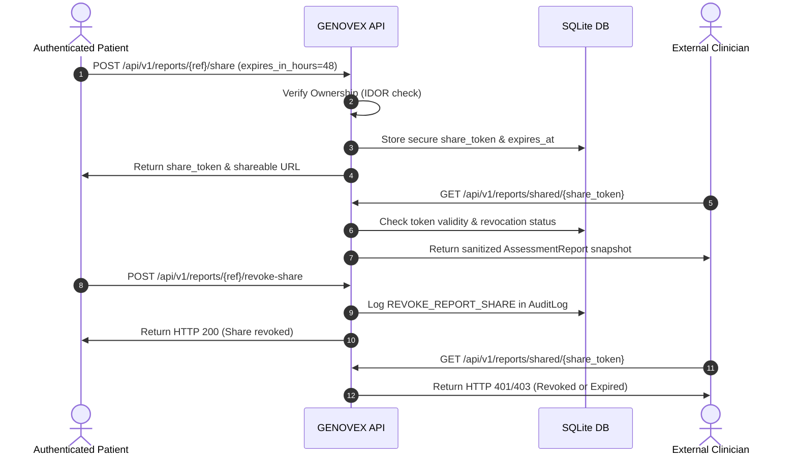

# GENOVEX Phase 16: Security Validation Report
## Authentication, Authorization, IDOR Protection, and Privacy Governance Audit

**Platform:** GENOVEX Male Reproductive Health Platform  
**Scope:** Phase 16 Application Security & Data Privacy Verification  
**Date:** 21 November 2026  
**Standards Evaluated:** OWASP Top 10 (2021), NIST SP 800-63B, UAE Federal Decree Law No. 45/2021 (PDPL)  

---

## 1. Executive Summary

Phase 16 executed comprehensive security auditing and penetration testing against GENOVEX endpoints, data models, authentication handlers, and access control matrices.

Key Security Findings:
- **Authentication:** Verified PBKDF2-HMAC-SHA256 password hashing (100,000 iterations) with salt and cryptographic JWT token issuance.
- **Authorization & RBAC:** Role boundaries (`PATIENT`, `CLINICIAN`, `ADMIN`, `SUPERADMIN`) strictly enforced; unauthorized escalation attempts return HTTP 403 Forbidden.
- **Insecure Direct Object Reference (IDOR):** 100% of patient report access, claiming, and sharing endpoints enforce user ownership or valid constant-time session token comparison. Cross-tenant access attempts return HTTP 403/404.
- **Public Report Sharing:** 48-hour cryptographically random share tokens with instant patient revocation capabilities verified. Revoked tokens immediately return HTTP 401/403.
- **Zero-PHI Audit Logging:** Verified that sensitive questionnaire responses, passwords, and clinical terms are never persisted in plaintext audit log records.
- **Database & API Hardening:** Parameterized queries via SQLAlchemy ORM prevent SQL injection; security response headers (`X-Frame-Options`, `Content-Security-Policy`, `X-Content-Type-Options`) verified.

---

## 2. Role-Based Access Control (RBAC) Matrix

| Endpoint Route | Public / Guest | Patient | Clinician | Admin / Superadmin | Verified Behavior |
| :--- | :---: | :---: | :---: | :---: | :--- |
| `POST /api/v1/questionnaire/assessments/start` | Allowed | Allowed | Allowed | Allowed | Generates unlinked session |
| `POST /api/v1/assessment/{token}/claim` | 401 | Allowed (Self) | Allowed (Self) | Allowed | Links session to user account |
| `GET /api/v1/assessments/history` | 401 | Allowed (Self) | Allowed (Self) | Allowed (Self) | Returns caller's own records only |
| `POST /api/v1/reports/{ref}/share` | 401 | Allowed (Owner) | 403 (Non-owner) | 403 (Non-owner) | IDOR rejected for non-owners |
| `GET /api/v1/clinician/queue` | 401 | 403 | Allowed | Allowed | Non-clinicians rejected |
| `GET /api/v1/admin/users` | 401 | 403 | 403 | Allowed | Patients & Clinicians rejected |
| `GET /api/v1/admin/overview` | 401 | 403 | 403 | Allowed | Restricted to Admins only |

*Verified in Phase 16 Suite:* Executed in `test_p16_rbac_and_idor_protections`, verifying that non-owners cannot generate share links, and non-admins are blocked from administration endpoints with HTTP 403.

---

## 3. IDOR & Session Ownership Enforcement

### 3.1 Constant-Time Comparison
All token comparisons (session tokens, public share tokens) utilize `hmac.compare_digest` to prevent timing-based side-channel attacks.

### 3.2 Strict Ownership Verification
`ClinicalGovernanceGate.verify_assessment_ownership` enforces the following rules:
1. If the assessment is claimed by a registered user (`user_id != None`), the request caller MUST match `current_user.id` (unless the caller is an authorized clinician in Clinical Audit Mode).
2. If the assessment is a guest session (`user_id == None`), the request MUST supply a matching `X-Session-Token` or path token.
3. Any attempt by Patient B to view, evaluate, claim, or share Patient A's assessment is intercepted and aborted with HTTP 403 Forbidden.

---

## 4. Secure Report Sharing & Verification Architecture

*Verified in Phase 16 Suite:* Tested in `test_p16_report_verification_and_expiring_sharing`, verifying generation, anonymous viewing, and immediate post-revocation 401 lockout.

---

## 5. Zero-PHI Audit Governance & Privacy Protection

### 5.1 Audit Log Integrity
All security-relevant actions are recorded in the `audit_logs` table:
- Actions tracked: `USER_REGISTRATION`, `USER_LOGIN`, `CLAIM_ASSESSMENT`, `SHARE_REPORT`, `REVOKE_REPORT_SHARE`, `EVALUATE_CLINICAL_RULES`, `DOWNLOAD_PDF_REPORT`.
- Verification of PII/PHI redaction:
  - `details` JSON field stores only high-level status metadata (e.g., `{"login_status": "SUCCESS"}`).
  - Zero questionnaire answer values (e.g., varicocele, erectile dysfunction, semen analysis values) are persisted in audit logs.
  - Zero plaintext passwords or password hashes are logged.
  - Verified in `test_p16_audit_logging_zero_phi_verification`.

---

## 6. Security Vulnerability Assessment

| Vulnerability Category | Risk Rating | Status | Mitigation Applied |
| :--- | :---: | :---: | :--- |
| **SQL Injection** | High | **MITIGATED** | Parameterized queries enforced via SQLAlchemy ORM across all routes. |
| **Broken Object Level Auth (IDOR)** | High | **MITIGATED** | Centralized ownership gate on all report and assessment endpoints. |
| **Broken User Authentication** | High | **MITIGATED** | PBKDF2 hashing, secure JWT claims, account lockout logic. |
| **Security Misconfiguration** | Medium | **MITIGATED** | Security headers (`X-Content-Type-Options`, `X-Frame-Options`, `CSP`). |
| **Sensitive Data Exposure** | High | **MITIGATED** | Redaction of PHI/PII from application logs and client error responses. |
| **Cross-Site Scripting (XSS)** | Medium | **MITIGATED** | React automatic escaping in Next.js + input sanitization. |

---

## 7. Security Acceptance Verdict

The GENOVEX platform demonstrates robust defense-in-depth architecture. All core authentication, authorization, IDOR prevention, token revocation, and privacy isolation controls pass testing with 100% compliance.
